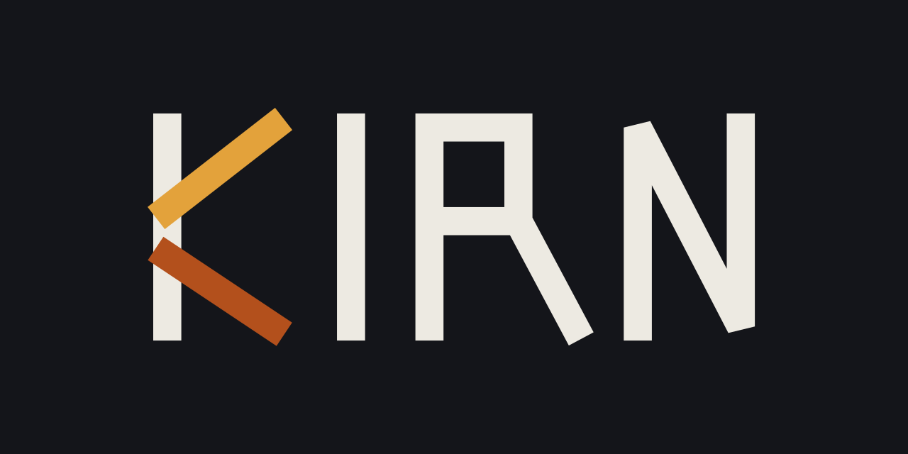

  

<h1 align="center">Kirn Programming Language</h1>

The source repository for the Kirn programming language and compiler.

  
  

## Overview

Kirn is an open-source general-purpose programming language created by RK Riad Khan. This repository contains the compiler, grammar, examples, standard-library work, tooling, and the VitePress documentation site.

## Website and source

- [Project website](https://rkriad585.github.io/kirn/)
- [Source repository](https://github.com/rkriad585/kirn)
- [Creator: RK Riad Khan](https://rkriad585.github.io/)

## Kirn ecosystem

- [Creator website](https://rkriad585.github.io/)
- [KirnOS website](https://kirnos-kernel.github.io/)
- [Kirnly website](https://kirnly.github.io/)
- [Pets registry website](https://pets-registry.github.io/)
- [Kirn website](https://kirn-lang.github.io/)
- [Kirn documentation](https://rkriad585.github.io/kirn/)
- [Pets contribution docs](https://pets-registry.github.io/pets)

## Local development

This repository contains a static website or documentation site. Follow the repository-specific instructions below.

~~~bash
cd docs-site
npm install
npm run docs:dev
~~~

For VitePress repositories, open the local URL shown by the development server. For static websites, open <http://localhost:8000/>.

## Repository contents

- `README.md` — project overview and ecosystem links
- `LICENSE` or `LICENSE.txt` — open-source license
- `CONTRIBUTING.md` — contribution workflow
- `SECURITY.md` — private vulnerability-reporting guidance
- `CODE_OF_CONDUCT.md` — community expectations

## Contributing

Please read [CONTRIBUTING.md](CONTRIBUTING.md), [CODE_OF_CONDUCT.md](CODE_OF_CONDUCT.md), and [ACCESSIBILITY.md](ACCESSIBILITY.md) before opening a pull request. Report security issues privately using [SECURITY.md](SECURITY.md).

## License
